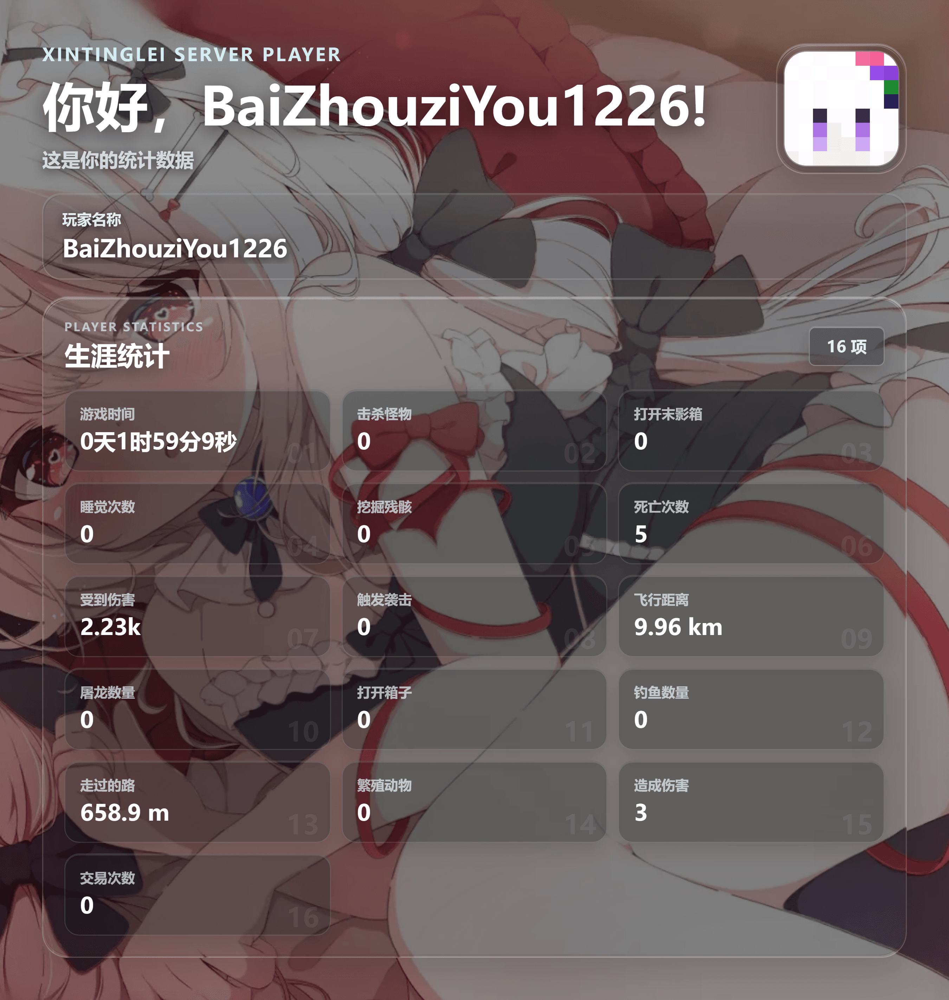

# 玩家统计资料卡

# 关于渲染过慢问题

可在渲染时机中选择“自定义渲染时机”，完成时机设置为 `Networkidle0`，渲染延迟设置为 `0.5s`，其余选项保持不变。

# 特别功能

- 支持 EasyBot 内置统计变量与 PAPI 变量，可自由配置统计项目
- 支持 `&#RRGGBB`、`§x§R§R§G§G§B§B` 等 HEX 十六进制颜色码
- 游戏时间自动换算为天、时、分、秒
- 距离可选择使用 m / km 简略显示，或显示完整米数
- 大数可选择使用 k / M 简略显示，或显示完整数字
- 完整数字可选千位分隔符，默认关闭
- 支持更换皮肤源为 LittleSkin 或自建 Blessing Skin
- 默认资源使用国内源，包括头像与随机背景获取，降低服务器无法访问境外资源时的加载风险
- 支持混合使用多个皮肤源，并按自定义顺序自动回退
- 支持液态玻璃效果，可根据需求调整折射范围与光照方向
- 支持更高清的输出效果
- 支持高度自定义

## 详细功能清单

- 支持生成独立玩家统计资料卡
- 支持读取触发消息中的玩家名称
- 支持 EasyBot 内置 `%ez-statistic_...%` 统计变量
- 支持 PAPI 变量，可自定义最多 24 个统计项目
- 多个统计变量合并为一次请求，减少接口调用次数
- 支持自动格式化游戏时间为天、时、分、秒
- 支持距离简略显示，例如 `59.8 km`
- 支持距离完整显示，例如 `59770.65 m`
- 支持大数简略显示，例如 `40.1k`
- 支持大数完整显示，例如 `40092`
- 支持可选千位分隔符，例如 `40,092`
- 支持常见 Minecraft/PAPI HEX 十六进制颜色码，其他颜色与样式控制符会自动剥离
- 未解析或不可用的变量统一显示为 `--`
- 统计项目采用每行三项布局，所有数值保持统一字号
- 支持实时获取并展示玩家头像
- 默认使用[新亭泪](https://xintinglei.cn)国内镜像头像源
- 默认使用带帽子/头发外层头像样式，显示效果更好
- 支持 Blessing Skin / LittleSkin / 第三方皮肤站头像源
- 支持自定义头像 URL 模板
- 支持按自定义顺序混合使用多个头像源
- 头像加载失败时自动兜底为 Steve 头像
- 支持默认背景、自定义背景、随机背景
- 随机背景支持类似于 `https://t.alcy.cc/moez` 的直链随机图接口
- 支持调节背景暗化强度
- 支持经典深色与 WebGL 液态玻璃主题
- 液态玻璃支持清澈、着色外观以及折射范围、光照方向调节
- 支持标准、高清、超清及更高分辨率输出
- 内置 Noto Sans SC 与 Source Han Sans SC / 思源黑体
- 支持自定义 CSS
- 支持玩家统计数据缓存与头像缓存
- 提供 Debug 日志记录、导出与清空功能
- 提供图形化配置页面
- 提供预览编辑页面

## 关于

- 作者：`BaiZhouziYou`
- 版本：`v1.1.3`
- 反馈方式：发送邮件至 `reedtxt@icloud.com`，或在任意 EasyBot 用户群 @一只白洲梓鼬（307352519）。建议优先发送邮件，QQ群消息可能无法及时看到。

## 开源说明

自有程序源码采用 AGPL-3.0-only 及仓库中的附加条款；参见根目录 LICENSE、NOTICE.md、THIRD_PARTY_NOTICES.md 和 docs/ADDITIONAL_TERMS.md。字体、第三方库和媒体素材分别遵循各自声明。

本目录保留模板源码与封面、预览图片，不含安装 ZIP、打包脚本、QA 脚本或下载图库。
