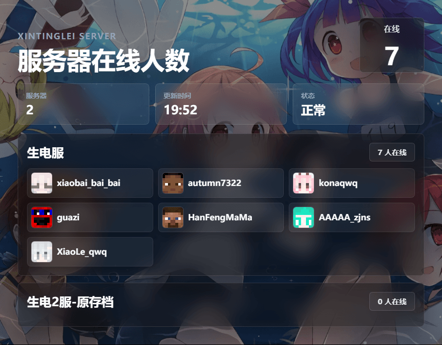
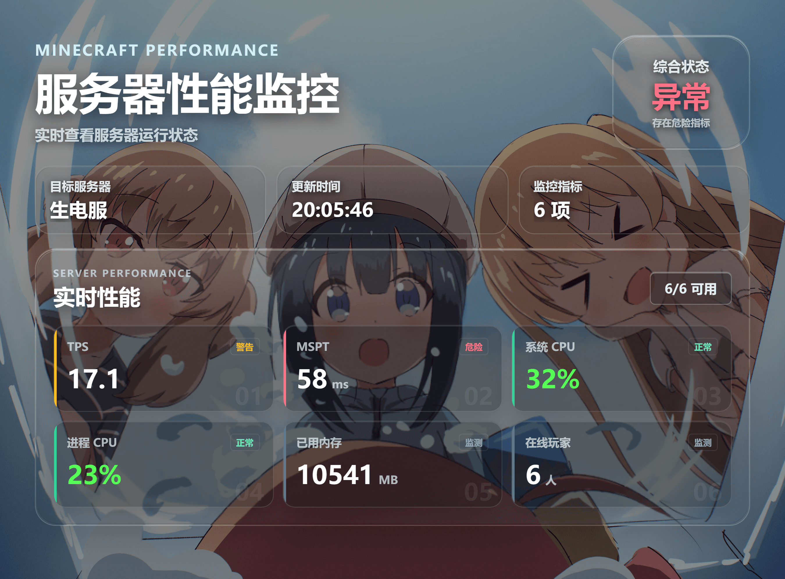

# EasyBot Image Templates

由 BaiZhouziYou 开发的 EasyBot 图片模板合集仓库

各模板独立安装、独立版本，共用经典深色与 WebGL 液态玻璃风格，支持图形化设置、内置中文字体、多档输出清晰度及自定义 CSS

## 目前已有模板

| 模板 | 版本 | 功能 | 使用说明 |
| --- | --- | --- | --- |
| 服务器在线列表 | 1.2.0 | 多服务器在线人数、玩家列表、头像源回退与服务器筛选 | [说明](EasybotImageTemplate-WebGL/README.md) |
| 玩家统计资料卡 | 1.1.3 | EasyBot/PAPI 变量、最多 24 项统计、时间与数字格式化 | [说明](EasybotPlayerStatsTemplate-WebGL/README.md) |
| 服务器性能监控 | 1.1.1 | 多服分组、逐服配置、Fabric/Bukkit 预设、最多 18 项指标及状态阈值 | [说明](EasybotServerPerformanceTemplate-WebGL/README.md) |

### 目前下载量(Easybot资源市场-图片模板分区)(截至于2026/10/18)


### 服务器在线列表



### 玩家统计资料卡


### 服务器性能监控



## 目录与使用

一款模板一个文件夹，文件夹内的 `manifest.json` 是模板清单，`index.html` 是图片页面，`settings.html` 是配置页面，`assets/` 包含脚本、样式、字体及封面

```text
EasybotImageTemplate-WebGL/                # 服务器在线列表
EasybotPlayerStatsTemplate-WebGL/          # 玩家统计资料卡
EasybotServerPerformanceTemplate-WebGL/    # 服务器性能监控
```

运行需要支持图片模板的 EasyBot 和可用的图片渲染器；涉及 PAPI 的功能还需要对应服务器插件或模组

本仓库提供源码，不包含安装包或打包脚本。若自行制作安装包，应将单个模板的 `manifest.json`、HTML 页面及 `assets/` 放在 ZIP 根目录，同时附带项目许可证、署名、附加条款和第三方说明

GitHub 的 **Download ZIP 是整个仓库源码，不能作为单个模板安装包导入**

## 授权

Copyright © 2026 BaiZhouziYou

自有程序源码采用 **AGPL-3.0-only**，并适用 [附加条款](docs/ADDITIONAL_TERMS.md)

设计沿用 [新亭泪官网项目](https://github.com/BaizhouziYou/xintinglei-website) 

完整正文见 [LICENSE](LICENSE)，项目署名见 [NOTICE.md](NOTICE.md)

第三方库和字体继续采用各自许可证，见 [THIRD_PARTY_NOTICES.md](THIRD_PARTY_NOTICES.md)

封面和预览图片单独列于 [媒体素材说明](docs/ASSET-LICENSES.md)，不因源码开源而获得第三方素材的再授权

## 问题反馈与建议
仓库 Issues 或 reedtxt@icloud.com
